# MotoNav

Android 手机配合 ESP32-S3 1.85b圆屏的导航项目。 和ESP32-C3

**本项目借助 AI 辅助开发，由个人进行需求设计、设备验证和迭代。仅供个人非商业使用与学习交流，禁止未经许可的商业使用及转售。**

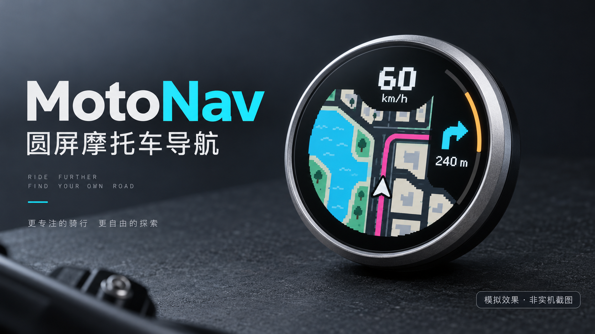

**上图为 AI 模拟效果，非实机截图。** 手机负责定位、路线与数据处理，圆屏展示导航、天气和音乐控制信息。

## 装到车上是什么样

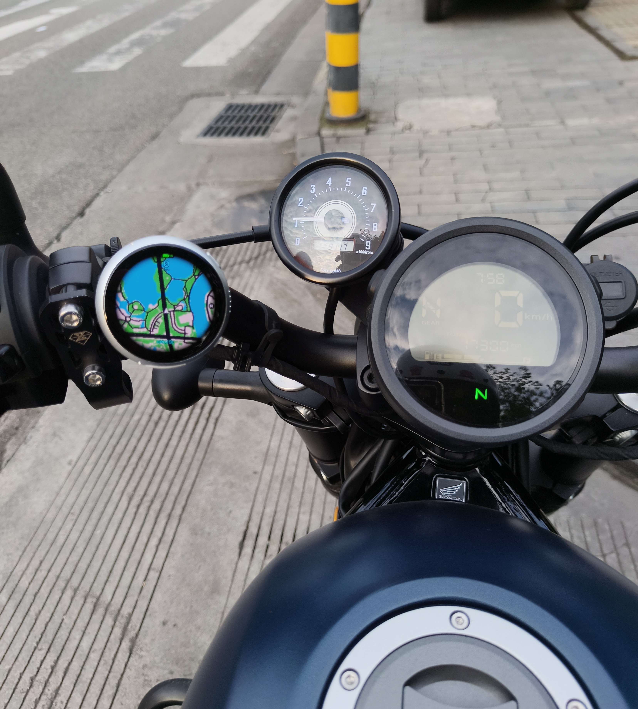

用户提供的停车安装实拍。小圆屏可固定在车把附近，具体支架、供电和安装方式由使用者按车辆情况安排。

## 实机画面

| 导航与路线 | 音乐控制 | 降水与空气 |
| :---: | :---: | :---: |
| 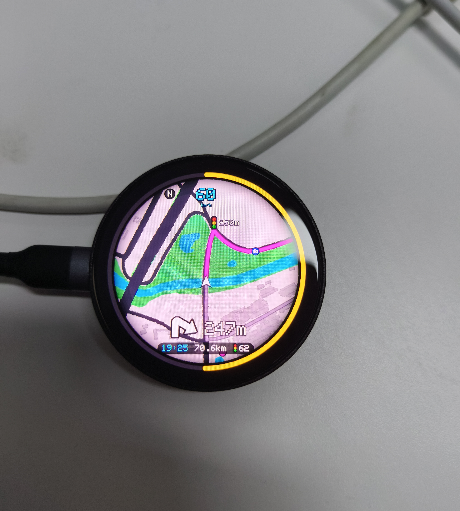 | 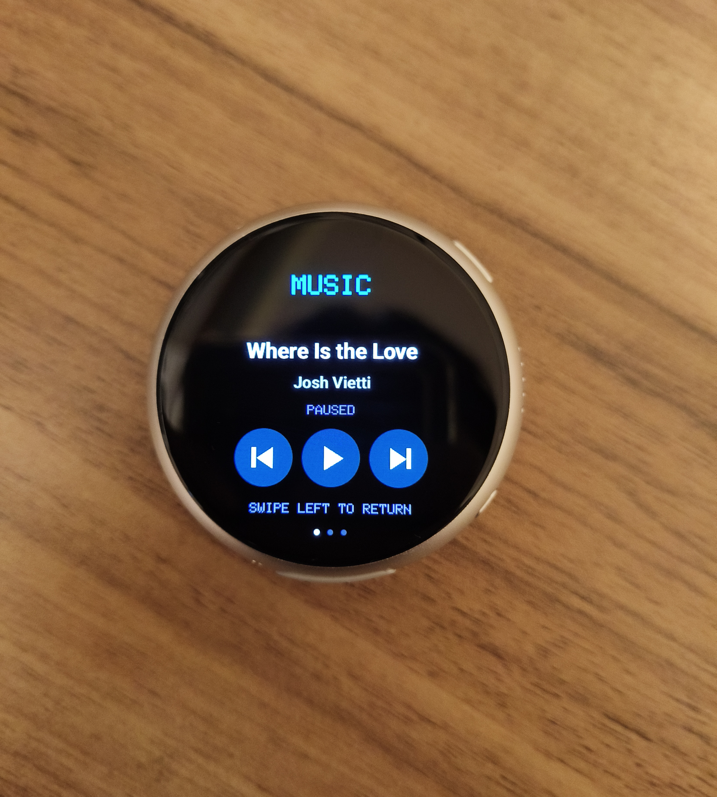 | 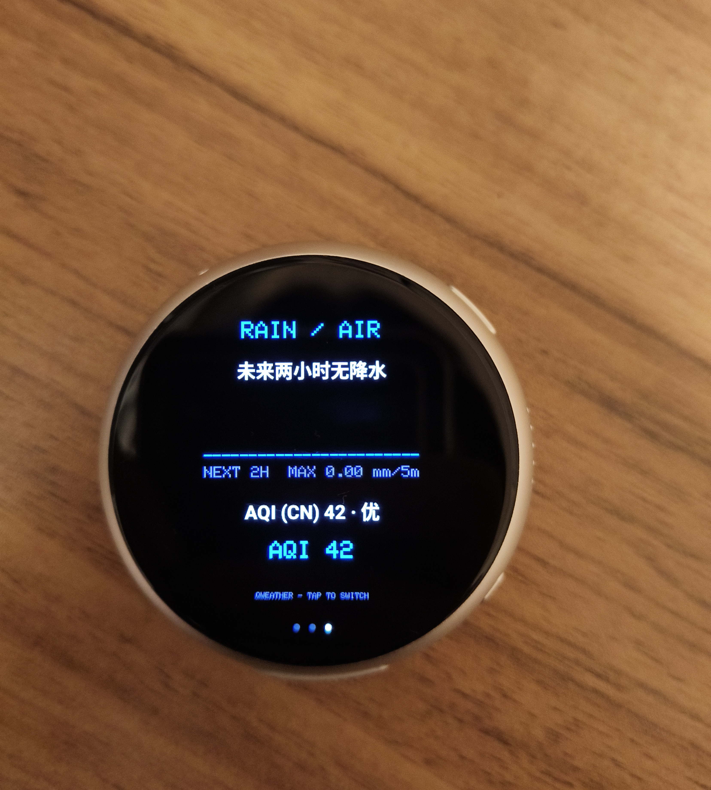 |
| 地图、转向距离、车速及行程环；桌面演示 | 查看曲目，控制上一首、播放/暂停、下一首 | 查看短时降水趋势及空气质量 |

| 天气主页 | 天气预警 | 启动就绪 |
| :---: | :---: | :---: |
| 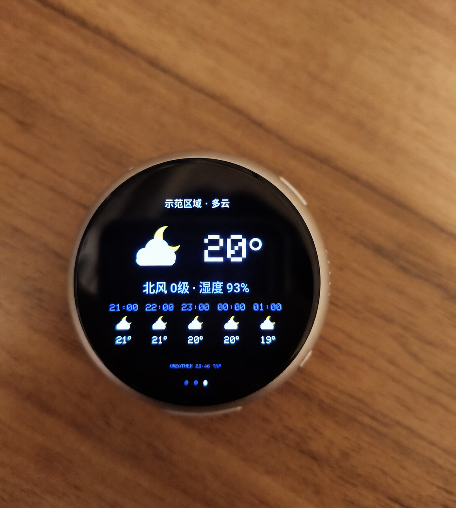 | 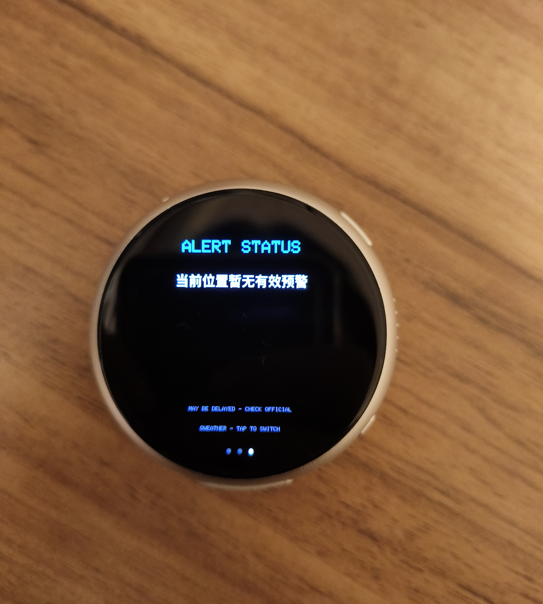 | 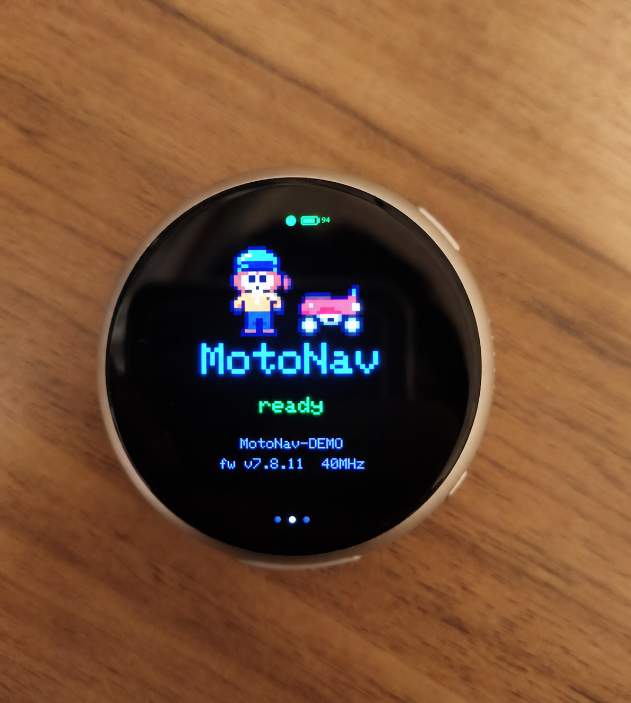 |
| 实况与未来五小时预报；**照片经 AI 隐私处理，地名已替换** | 拍摄时显示暂无有效预警 | **照片经 AI 隐私处理，设备后缀已替换** |

天气照片中的数据仅代表拍摄时的显示内容。经过隐私处理的两张图片不是原始照片，界面细节可能有变化。

## 动态演示

点击预览可打开对应 MP4。以下均为实机拍摄的桌面演示，视频已静音。

| 导航画面 | 路线与行程环 | 龙珠雷达风格 |
| :---: | :---: | :---: |
| [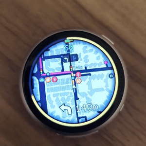](docs/media/videos/navigation-demo.mp4) | [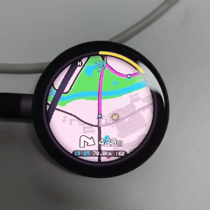](docs/media/videos/route-progress-demo.mp4) | [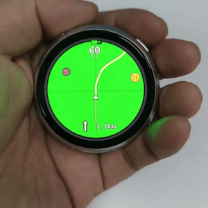](docs/media/videos/radar-demo.mp4) |

## 模拟效果展示

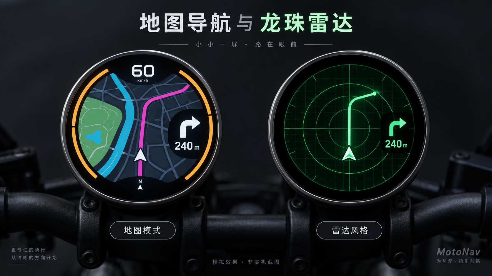

两种导航视觉的概念展示，**AI 模拟效果，非实机截图**。

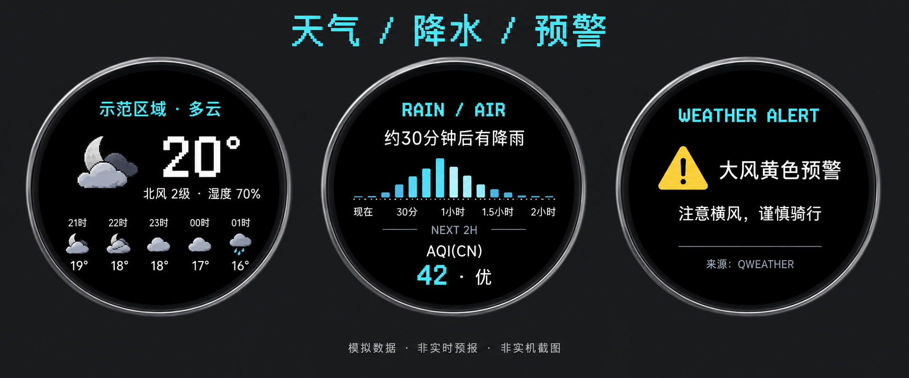

天气页面概念展示，**AI 模拟效果；数据虚构，非实时预报**。实际界面、数据可用性和硬件外观以当前软件及设备为准。

[查看完整素材说明](docs/MEDIA.md) · [打开离线展示页](docs/showcase.html)

## 支持的硬件

- Waveshare ESP32-S3-Touch-AMOLED-1.75，466×466。

本说明仅介绍上述 1.75 英寸板型，其余板型不列入当前支持范围。M5Stack StopWatch 不包含在本仓库。

## 功能

地图、路线、转向提醒、车速、行程环、胎压显示、G值表、巡航、音乐控制和品牌开机动画；保留摩托车、驾车、自行车的路线分享处理。高德网页无法还原原路线时，按界面提示处理，不保证所有分享链接都能还原。

天气改用和风天气：实况、未来五小时预报、短时降水、空气质量和官方预警。圆屏天气页轻点循环显示主页、降水/空气、预警摘要；手机可查看完整详情及来源。仍按查看天气触发查询，并使用缓存，不在导航后台持续轮询天气。

## Windows 一键打包

1. 下载仓库 ZIP 并完整解压到较短的本地路径。
2. 双击根目录“一键打包.bat”。不需要 Android Studio。
3. 首次需要联网下载 JDK、Android SDK、Gradle 和依赖；SDK 许可由官方工具提示，阅读后自行决定是否接受。
4. 成功后 output/MotoNav-personal.apk 是安装包，output/Application-info.txt 包含生成的包名和签名 SHA1。

发布版安装包固定使用包名 `com.fallendawn.motonav`。源码命名空间 `com.example.motonav` 与实际安装包 applicationId 可以不同。

**更新前必须备份 android/personal.properties 和整个 android/keystore 文件夹。新版解压后先复制回这两项，再打包，才能沿用包名、证书和地图绑定信息。不要把生成后的个人工程或证书公开上传。**

本仓库不包含编译工具、依赖缓存、APK、个人签名或地图天气凭据。国内网络访问部分官方下载站点可能需要额外的网络配置。

已有环境可执行：

```powershell
.\Build-Personal.ps1 -JavaPath 'D:\Tools\jdk-17' -SdkPath 'D:\Tools\android-sdk' -GradlePath 'D:\Tools\gradle\bin\gradle.bat'
```

已缓存所需依赖时可追加 -Offline。

## 地图与天气配置

安装后在手机首页“地图 Key”配置：

- 高德：Android 平台 SDK Key，绑定实际安装包的包名和发布证书 SHA1。地图、搜索、算路和导航仍依赖高德。
- 天地图：按所用 HTTP 地图服务申请对应 Key。仅选择天地图底图或卫星风格时需要。
- 和风：在“和风天气 → 配置”填入自己账号的 API Host 与 API Key，启用天气预报、分钟降水、空气质量和天气预警。凭据不内置。

服务权限、使用范围、请求额度、署名及计费以各服务商现行规则为准。不同用户重新签名并不自动获得服务授权。天气与预警可能延迟，不替代官方最新发布。

## 固件构建

## 可视化 UI 编辑器

项目根目录的 `ui-editor` 是一个无需安装依赖的双模式可视化编辑器：`Android App` 模式编辑首页、路线规划、导航中、设置和骑行记录；`ESP32 圆屏` 模式编辑 175、185B、C3 屏幕的开机、导航、待机、天气和音乐页面。两种模式分别保存控件数据，避免混用坐标和导出格式。

启动方式：

```powershell
python -m http.server 8765 --directory ui-editor
```

然后打开 `http://localhost:8765`，先在顶部选择 `Android App` 或 `ESP32 圆屏`。选择页面后，从左侧添加控件，在预览上拖动，或在右侧属性面板调整位置、尺寸、文字、颜色和字号。“保存项目”将草稿保存到当前浏览器；Android 模式可导出 XML/Compose/JSON，ESP32 模式可导出 JSON/C++。

“保存项目”会同时写入浏览器 `localStorage`，并下载 `motonav-android-<页面>.json` 或 `motonav-esp32-<页面>.json`；浏览器通常将文件放在系统“下载”目录。它不会直接改写 Android 工程源码。

要真正修改手机 App：当前工程没有 XML 布局，界面是 Kotlin 代码动态创建的。首页入口在 `android/app/src/main/java/com/example/motonav/MainActivity.kt` 的 `onCreate` 和 `header`、`setupCard`、`searchCard`、`statusCard`、`section` 等函数；路线/导航视觉组件在 `android/app/src/main/java/com/example/motonav/NavUi.kt` 和 `android/app/src/main/java/com/example/motonav/RoutePlanActivity.kt`。编辑器导出的 XML/Compose 需要人工合并到这些页面，业务点击、蓝牙、地图和权限逻辑仍保留在 Kotlin 中。

firmware/boards/175/MotoNav 是 1.75 英寸板型的工程；firmware/libraries 保留所需第三方库源码。

使用 PlatformIO 构建 1.85B 固件。打开 `firmware` 目录后执行：

```powershell
pio run -e esp32s3-185b
```

也可以使用 `esp32c3_128x160`。1.75 英寸板型环境目前暂时禁用。上传使用 `pio run -e <environment> -t upload`；选择多个设备时在 PlatformIO 中指定串口。

## 检查与验证范围

android/tests/run.ps1 可运行巡航计时、地图风格与区县格式检查。天气解析测试见 android/tests/QWeatherClientTest.java，需要完成 App 编译、Kotlin 运行库及 org.json 测试运行库。

天气实现原版已完成 App、1.75 英寸板型固件的编译，以及接口示例数据解析检查；公开命名空间导出已构建验证。上方实拍来自用户提供的设备记录，软件检查与展示素材不代表独立路测或全场景验证通过。


## 依赖与许可

licenses 和各第三方库目录保留原许可及版权声明。高德 SDK 通过构建依赖获取，地图/天气数据按服务商规则使用。品牌标识属于各自权利人。

项目自有代码及原创素材按 [非商业使用条款](LICENSE.md) 提供，不采用 MIT/Apache 等允许商业使用的许可。禁止未经许可倒卖源码、固件、安装包，或以付费代刷、打包销售、硬件捆绑销售等方式获利。第三方组件、地图和天气服务仍适用各自的许可及规则。

## ESP32 PlatformIO / VS Code

The firmware can be opened as a PlatformIO project by opening the `firmware` folder in VS Code and installing the recommended PlatformIO IDE extension. The active build environments are:

- `esp32s3-185b` — Waveshare 1.85B board
- `esp32c3_128x160` — ESP32-C3 128x160 board

The `esp32s3-175` environment is temporarily disabled.

Use the PlatformIO toolbar or run `pio run -e esp32s3-185b` from `firmware`. Upload with `pio run -e <environment> -t upload`; select the serial port in PlatformIO when more than one device is connected.
